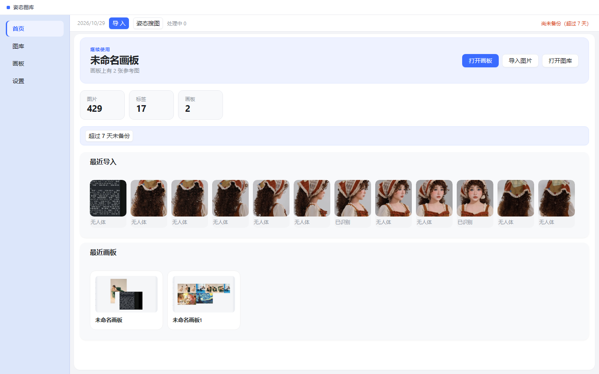
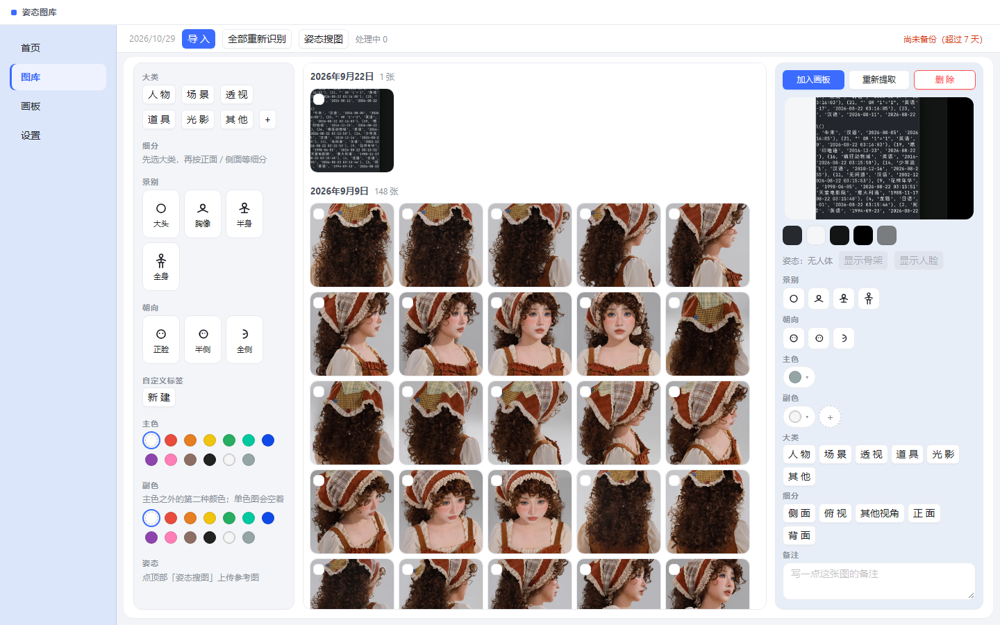
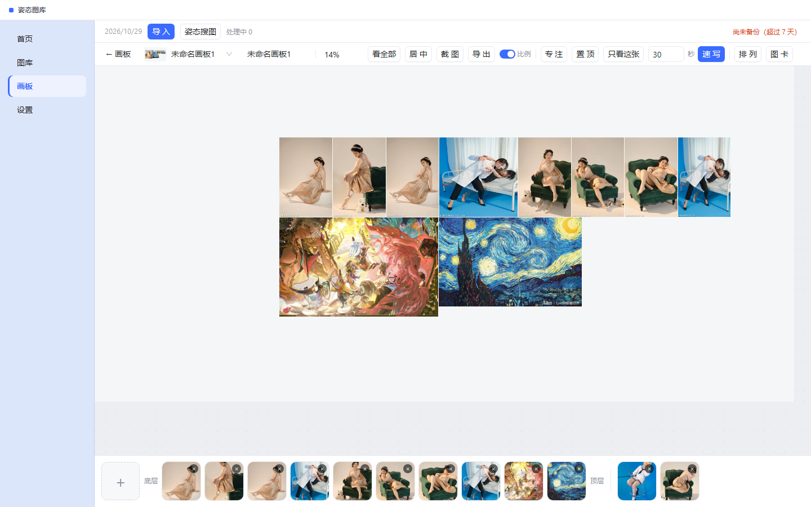
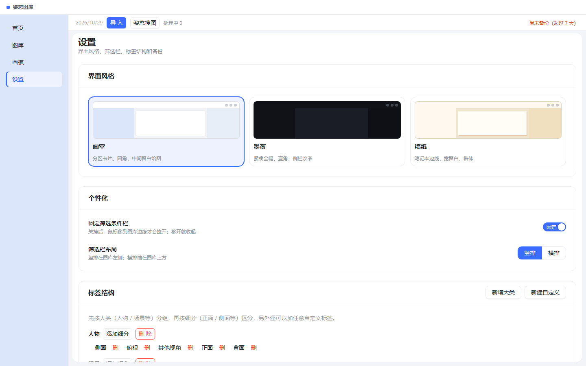

# 姿态图库

把参考图放在自己电脑里，按姿势、景别、朝向、颜色或标签找到，再摆到画板上对照。

这是 Windows 桌面应用，不是网站。图和画板都存在本机，不会上传。

## 能做什么

- **入库**：导入文件或整个文件夹。重复的图会自动跳过。
- **筛选**：按大头 / 胸像 / 半身 / 全身、正脸 / 半侧 / 全侧、衣服颜色、自己打的标签查找。
- **看姿势**：图库里可以叠骨架或脸部点；也能用一张图去搜库里动作接近的参考。
- **画板**：把多张图摆在一起对照，支持移动、缩放、旋转、裁剪、编组。关掉再开，布局还在。
- **截图**：截屏后可以进图库，也可以直接放到当前画板。
- **对着画**：窗口可以置顶、半透明、贴边悬浮，方便开着画图软件一起用。
- **备份**：在设置里备份整库；换电脑或重装前先备份，再恢复。

## 怎么打开

安装后从桌面或开始菜单打开 **姿态图库**。适用于 Windows 10 / 11。

第一次识别姿势时需要联网下载模型，之后可以离线用。

## 界面

左侧四个入口：

| 页面 | 做什么 |
|---|---|
| 首页 | 看最近的图和画板，继续上次的工作 |
| 图库 | 浏览全部参考图，筛选、打标、预览 |
| 画板 | 管理画板；点进去在画布上摆图 |
| 设置 | 换外观、整理标签、备份和恢复 |

**首页**

**图库**

**画板**

**设置**

## 常用操作

**导入**  
用顶栏的导入，选图片或文件夹。导入后会在后台识别姿势和颜色，稍等即可按景别、朝向筛选。识别不准时，可在图详情里手动改。

**找图**  
在图库用颜色、景别、朝向、标签缩小范围。想找相似动作时，用姿势搜图，选一张库内图或另选一张查询图。

**对照**  
把图加入画板，在画布上拖到合适位置。需要盯着一张图画画时，可以用置顶或悬浮小窗。

**截图**  
快捷键 <kbd>Ctrl</kbd>+<kbd>Shift</kbd>+<kbd>S</kbd>。按提示框选屏幕，再选择进图库还是进画板。

**备份**  
设置 → 备份。建议定期做一份；恢复前会再自动保存当前库，避免覆盖错。

## 数据在哪

图片、标签和画板保存在本机：

`C:\Users\你的用户名\AppData\Roaming\PoseBoard\`

卸载软件不会自动清空这里。不想保留时，可自行删除该文件夹。换设备请先备份，不要只拷贝安装目录。
